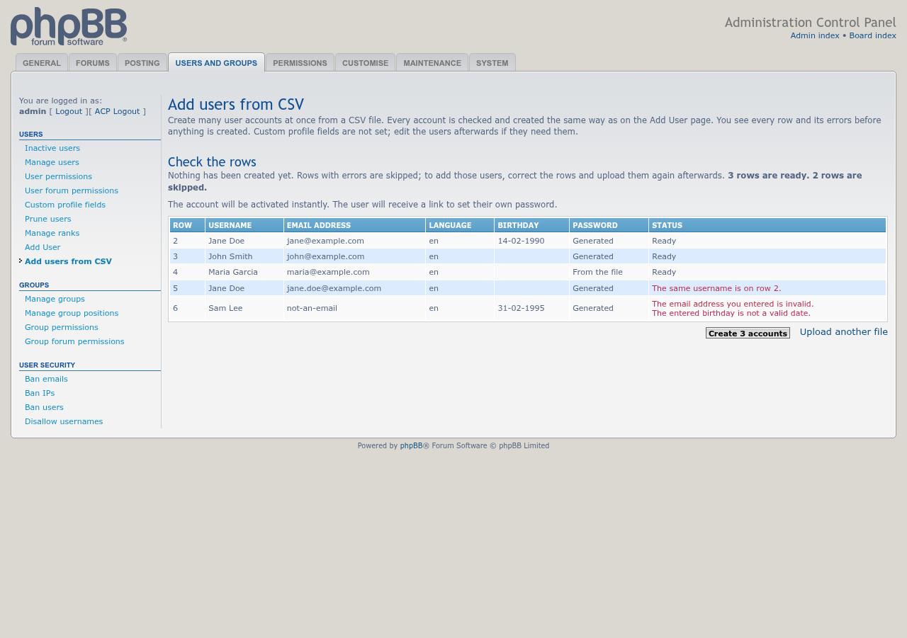
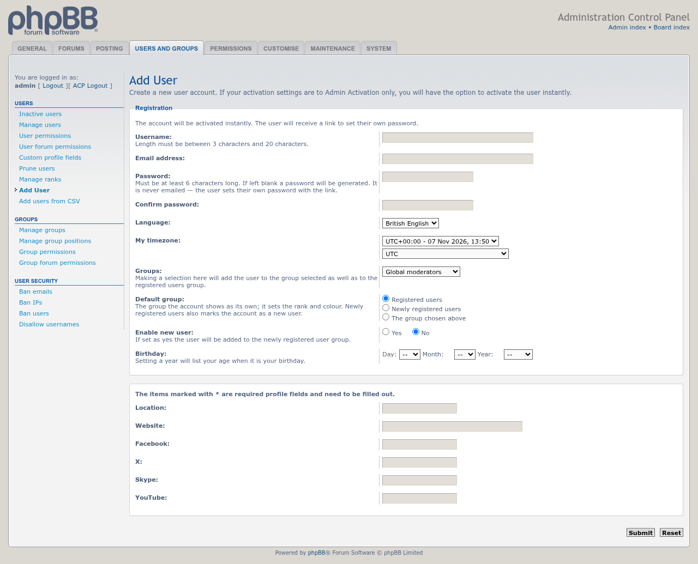
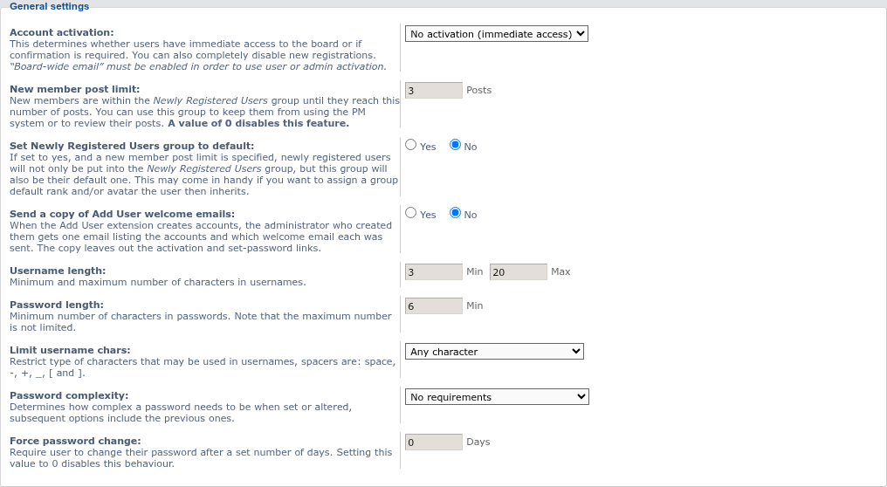

# Add User update screenshots — 11/07/2026

Screenshots of the changes in Add User 1.0.7-dev since the first development post: adding users from a CSV file, the default-group choice, and the administrator copy of welcome emails. Taken on phpBB 3.3 with the extension's ACP pages; nothing was created or sent.

## Add users from CSV

The check page after a CSV file was uploaded. Every row is checked with the same rules as the Add User page and shown with its errors before anything is created; rows with errors are skipped.

## Default group

The Add User page with a group chosen. The new Default group choice offers Registered users, Newly registered users, or the group chosen above, and starts out matching the board's own Newly registered users setting.

## Administrator copy of welcome emails

The new setting under ACP » Board settings » User registration settings. When it is on, the administrator who created accounts gets one email listing them, without the activation or set-password links.

